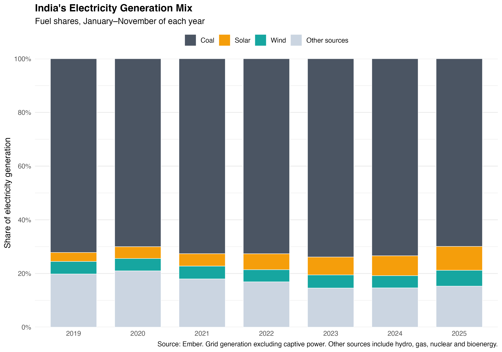
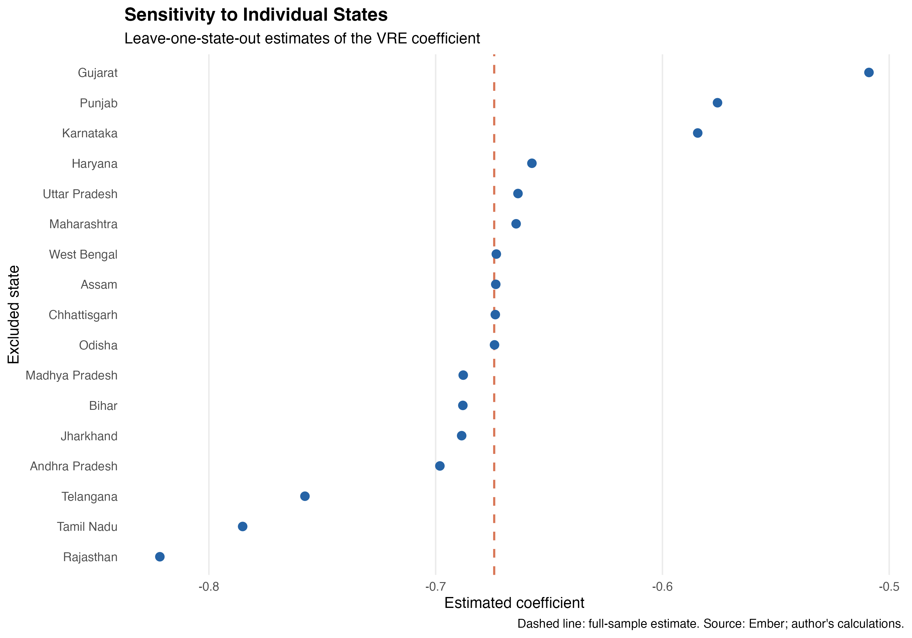

# India's Solar Transition and Coal Utilization

**Are increases in solar and wind generation shares associated with lower utilization of installed coal capacity across Indian states?**

Reproducible R coding sample · Mariia Maslova · Data: Ember, January 2019 – November 2025



## Summary

Using a monthly state-level panel of India's power sector, I relate each state's coal capacity factor (actual coal generation divided by the maximum possible generation from installed coal capacity) to the share of its electricity generated from solar and wind. With state and month fixed effects and standard errors clustered by state, a 1 percentage point higher solar-and-wind share is associated with a **0.67 percentage point** lower coal capacity factor (clustered SE 0.25; wild cluster bootstrap p = 0.027). Adding state-specific linear trends gives −0.82 (SE 0.28; bootstrap p = 0.009). The estimate is negative in every leave-one-state-out regression, ranging from about −0.82 to −0.51. These are observational associations, not causal estimates of displacement.

## Data

- **Source:** [Ember, India Electricity Data](https://ember-energy.org/data/india-electricity-data) (state-level, monthly, long format), licensed CC BY 4.0. File used: `india_monthly_full_release_long_format.csv`, downloaded 31 October 2026.
- **Coverage:** January 2019 – November 2025 (83 months), 36 states and union territories.
- **Variables used:** electricity generation by fuel (GWh), total generation (GWh), installed capacity by fuel (MW).

**Data decisions**

1. *India Total* is used only for national figures. Ember's total is the sum of state data and excludes captive (industrial) generation.
2. The residual *Others* geography, which Ember's methodology does not describe, is excluded from the state panel.
3. *Jammu and Kashmir* and *Ladakh* are combined for the whole period, because Ember reports them as one state until July 2021. Values are summed only when observed, so a fully missing group stays missing rather than becoming zero. The final panel has **35 regions × 83 months = 2,905 state-months**.
4. Coal capacity factor: `coal_cf = gen_coal / (cap_coal × hours in month / 1000)`. Renewable capacity is not used in regressions, because Ember fills missing months of solar and wind capacity with the nearest available value.

**Checks built into the code** (`stopifnot()`): unique state-month keys, a balanced panel, shares and capacity factors within [0, 1], and generation by fuel summing to total generation on complete rows (maximum discrepancy below 10⁻¹¹ GWh; 81 of 2,905 state-months have at least one missing fuel and are reported, not imputed). Missing values: coal capacity 5.2%, coal generation 2.8%, total, solar and wind generation 0%.

## Method

The regression sample keeps state-months with installed coal capacity and non-missing shares: **17 states, 81 months, 1,377 observations**. Delhi and Lakshadweep, which have only sparse zero-coal-generation rows, are excluded from the core sample and kept in an extended-sample check.

Baseline specification for state *s* and month *t*:

`CoalCF_st = β · VREShare_st + α_s + δ_t + ε_st`

- α_s: state fixed effects (time-invariant differences such as plant fleet and geography).
- δ_t: month fixed effects (national shocks, seasonality, COVID-19, fuel prices).
- Standard errors are clustered by state. Because there are only 17 clusters, I also report wild cluster bootstrap p-values (9,999 Rademacher draws, `fwildclusterboot`).

**Robustness:** extended sample including Delhi and Lakshadweep; separate solar and wind shares, with a test of their difference; solar and wind generation levels in TWh, which avoids total generation in the denominator; state-specific linear trends; and leave-one-state-out estimates.

## Results

| Specification | Coefficient on VRE share (pp) | Clustered SE | Bootstrap p | N |
|---|---:|---:|---:|---:|
| Two-way fixed effects | −0.674 | 0.245 | 0.027 | 1,377 |
| Two-way FE + state trends | −0.816 | 0.281 | 0.009 | 1,377 |

R² is 0.73 for the two-way FE model (within R² 0.13) and 0.79 with state trends (within R² 0.14). Including Delhi and Lakshadweep (N = 1,420) gives −0.562 (SE 0.195). Estimated separately, the solar share coefficient is −0.603 (SE 0.319) and the wind share coefficient is −0.734 (SE 0.267). Bootstrap: wild cluster bootstrap, 9,999 Rademacher draws, 17 state clusters. Full results: `tables/main_regression_results.csv`. Leave-one-state-out estimates: `tables/leave_one_state_out.csv`.



**Main findings**

1. Solar generation in India roughly tripled over the period, while coal still produced around 70% of grid electricity in every year (Figures 1–2).
2. Within states, months with a higher solar-and-wind share coincide with lower coal capacity utilization. The association is not driven by any single state: all 17 leave-one-state-out estimates are negative and significant at 5% with clustered standard errors; excluding Gujarat weakens the estimate the most (−0.51), and excluding Rajasthan strengthens it the most (−0.82).
3. Wind generation is strongly seasonal, peaking during the monsoon (June–August) at nearly twice its annual average, while coal generation stays close to flat across the year (Figure 5). This seasonality is why month fixed effects matter.
4. Evidence from generation levels is weaker. Wind generation is negatively associated with coal utilization (−3.28 pp per TWh, SE 1.43), but the solar coefficient is imprecise (−1.03, SE 0.98) and changes sign once state trends are added (8.56, SE 6.92), while the wind coefficient loses significance (−2.21, SE 1.53). The share-based association should therefore be read with caution.

## Limitations

- These are fixed-effects associations without an exogenous source of variation. Solar and wind output, demand and coal dispatch respond jointly to weather and the grid.
- Electricity is traded across state borders, so a state's renewable output can affect coal plants in other states.
- Shares are compositional, which is why level-based specifications are reported as a check.
- Coal capacity records are incomplete for some regions and months, and captive coal generation is not included.
- With 17 clusters, inference relies on the wild cluster bootstrap.

## Reproduce

Requirements: R ≥ 4.3 and the packages `tidyverse`, `janitor`, `lubridate`, `fixest`, `fwildclusterboot`, `dqrng`.

```r
# from the project root
source("india_solar_coal_coding_sample.R")
```

The script stops with an informative error if a package or the input file is missing. Most of the run time is spent on the wild cluster bootstrap (9,999 replications).

## Repository structure

```
india-solar-coal/
├── README.md
├── india_solar_coal_coding_sample.R   # full pipeline: cleaning, figures, regressions
├── data/
│   ├── raw/          # Ember CSV (input)
│   └── processed/    # panel.rds, regression_models.rds (created by the script)
├── figures/          # 01–06 PNG figures (created by the script)
└── tables/           # result tables in CSV (created by the script)
```

## Author

Mariia Maslova · msmaslova7@gmail.com · [mariiamaslova-research.netlify.app](https://mariiamaslova-research.netlify.app)

Data: Ember (CC BY 4.0). Code: MIT licence.
